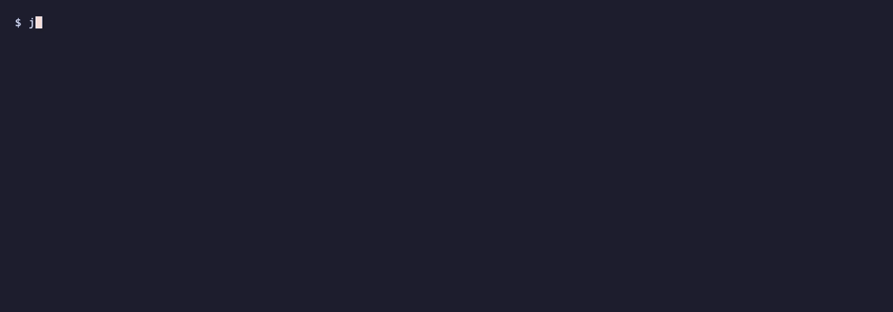

<!-- SPDX-License-Identifier: Apache-2.0 OR MIT -->

<p align="center">
  
</p>

<h1 align="center">jspassgen-sdk-cpp</h1>

<p align="center">
  The C++17 port of the jspassgen core, which today draws random bytes and unbiased integers from the operating system's CSPRNG; the password generators follow the conformance kit.
</p>

<p align="center">
  <a href="https://github.com/sebastienrousseau/jspassgen-sdk-cpp/actions/workflows/ci.yml"></a>
  <a href="https://github.com/sebastienrousseau/jspassgen-sdk-cpp/releases"></a>
  <a href="https://github.com/sebastienrousseau/jspassgen-sdk-cpp/blob/main/docs/index.md"></a>
  <a href="https://scorecard.dev/viewer/?uri=github.com/sebastienrousseau/jspassgen-sdk-cpp"></a>
  <a href="LICENSE-APACHE"></a>
  <a href="https://github.com/sebastienrousseau/jspassgen-sdk-cpp/blob/main/docs/POLICIES.md"></a>
</p>

<p align="center">
  
</p>

---

## Contents

**Getting started**

- [Install](#install): CMake `FetchContent`, `add_subdirectory`, or `find_package` on an installed prefix
- [Requirements](#requirements): toolchain floor, platforms
- [Quick Start](#quick-start): draw bytes and unbiased integers from the OS CSPRNG

**The jspassgen ecosystem**

- [The jspassgen ecosystem](#the-jspassgen-ecosystem): the core, its tools, the five native SDKs and the website

**Library reference**

- [Capabilities at a glance](#capabilities-at-a-glance): what exists today and what waits for the kit
- [Ecosystem comparison](#ecosystem-comparison): nothing to compare yet
- [Benchmarks](#benchmarks): none published yet
- [Features](#features): the random port and its OS backends
- [Configuration](#configuration): CMake options
- [Examples](#examples): runnable example index

**Operational**

- [When not to use jspassgen-sdk-cpp](#when-not-to-use-jspassgen-sdk-cpp): limitations
- [Development](#development): make targets, CI
- [Security](#security): guarantees and reporting
- [Documentation](#documentation): all reference docs
- [Stability guarantees](#stability-guarantees): versioning, output stability, toolchain floor
- [License](#license)

---

## Install

### As a C++ library

```cmake
include(FetchContent)
FetchContent_Declare(
  jspassgen
  GIT_REPOSITORY https://github.com/sebastienrousseau/jspassgen-sdk-cpp.git
  GIT_TAG        v0.0.22)
FetchContent_MakeAvailable(jspassgen)

target_link_libraries(your_app PRIVATE jspassgen::jspassgen)
```

`add_subdirectory` on a checkout works the same way. Tests, examples and
install rules are generated only when the library is the top-level
project.

To use an installed package, build and install a checkout, then find it
from any project:

```bash
cmake -S jspassgen-sdk-cpp -B build -DCMAKE_BUILD_TYPE=Release
cmake --build build
cmake --install build --prefix /opt/jspassgen
```

```cmake
find_package(jspassgen 0.0.22 CONFIG REQUIRED)  # with CMAKE_PREFIX_PATH=/opt/jspassgen
target_link_libraries(your_app PRIVATE jspassgen::jspassgen)
```

The package version file accepts the exact version only. Releases will
be GitHub releases with a source archive
([ADR 0002](docs/adr/0002-cmake-package-github-release-no-registry.md));
there is no vcpkg or Conan package.

---

## Requirements

- A C++17 compiler and CMake 3.20 or newer
  ([toolchain policy](docs/POLICIES.md)).
- CI builds with GCC and Clang 18 on Ubuntu 24.04, Apple Clang on
  macOS 15 and MSVC on Windows Server 2025. Other C++17 compilers are
  expected to work but are not tested.
- The random source compiles on Linux (`getrandom(2)`, glibc 2.25 or
  newer), macOS, FreeBSD, OpenBSD, NetBSD and DragonFly BSD
  (`arc4random_buf(3)`), and Windows (`BCryptGenRandom`). Any other
  platform fails to compile. The BSDs are not tested in CI.
- No run-time dependency. GoogleTest 1.18.0 (BSD-3-Clause) is fetched by
  CMake for the tests only, from its release archive pinned by SHA-256.

---

## Quick Start

```cpp
#include <array>
#include <cstdint>
#include <iomanip>
#include <iostream>

#include "jspassgen/jspassgen.hpp"

int main() {
  jspassgen::OsRandomSource source;

  std::array<std::uint8_t, 16> bytes{};
  source.fill_bytes(bytes.data(), bytes.size());
  std::cout << "jspassgen " << jspassgen::kVersion << "\nbytes: " << std::hex << std::setfill('0');
  for (const std::uint8_t byte : bytes) {
    std::cout << std::setw(2) << static_cast<unsigned>(byte);
  }

  std::cout << std::dec << "\ndie:  ";
  for (int roll = 0; roll < 5; ++roll) {
    std::cout << source.random_int(6) + 1 << ' ';
  }
  std::cout << '\n';
  return 0;
}
```

This is [`examples/random_draws.cpp`](examples/random_draws.cpp), which
`make check` builds and runs. `fill_bytes` fills a buffer from the OS
CSPRNG; `random_int(6)` returns an integer uniform in `[0, 6)` by
rejection sampling, not a modulo of raw bytes. No password generator
exists yet: see [Capabilities at a glance](#capabilities-at-a-glance).

---

## The jspassgen ecosystem

jspassgen is one core library and the tools, SDKs and site around it.
Every member is listed in
[`docs/ecosystem.json`](https://github.com/sebastienrousseau/jspassgen/blob/main/docs/ecosystem.json)
and, from the suite's first lockstep release, every member ships the same
version ([ADR 0001](https://github.com/sebastienrousseau/jspassgen/blob/main/docs/adr/0001-ecosystem-lockstep.md)).
The JavaScript tools depend on the core and add no generation logic of
their own; each SDK is a native port that is checked against the core's
conformance kit as its generators land.

| Component | Purpose | Use case |
| :--- | :--- | :--- |
| [`jspassgen`](https://github.com/sebastienrousseau/jspassgen) | Password and passphrase core, Node.js library, CLI, web UI and workers; source of the conformance kit | Programs that generate secrets |
| [`jspassgen-cli`](https://github.com/sebastienrousseau/jspassgen-cli) | Command-line generator built on the core | Passwords in a terminal or a script |
| [`jspassgen-mcp`](https://github.com/sebastienrousseau/jspassgen-mcp) | Local stdio MCP server | AI agents that need a generated secret |
| [`jspassgen-lsp`](https://github.com/sebastienrousseau/jspassgen-lsp) | Language server for weak literal secrets | Editors checking configuration and `.env` files |
| [`jspassgen-sdk-python`](https://github.com/sebastienrousseau/jspassgen-sdk-python) | Native port on the `secrets` module | Python programs |
| [`jspassgen-sdk-rust`](https://github.com/sebastienrousseau/jspassgen-sdk-rust) | Native port on the OS CSPRNG | Rust programs |
| [`jspassgen-sdk-java`](https://github.com/sebastienrousseau/jspassgen-sdk-java) | Native port on `SecureRandom` | JVM programs |
| [`jspassgen-sdk-dotnet`](https://github.com/sebastienrousseau/jspassgen-sdk-dotnet) | Native port on `RandomNumberGenerator` | .NET programs |
| **`jspassgen-sdk-cpp`** | Native C++17 port on the OS CSPRNG | C++ programs |
| [`jspassgen.github.io`](https://github.com/sebastienrousseau/jspassgen.github.io) | Source of [jspassgen.com](https://jspassgen.com) | Evaluating the suite |

Every member ships at 0.0.22, the suite's first lockstep release: the
core, CLI, MCP and LSP servers on npm, the Python, Rust, Java and .NET
SDKs on PyPI, crates.io, Maven Central and NuGet, and the C++ SDK and
the site as GitHub releases. The table gives each member's purpose, and
each README's Capabilities at a glance says what works today.

---

## Capabilities at a glance

| Area | Capability | Status |
| :--- | :--- | :--- |
| Random port | `RandomSource`: `fill_bytes`, `random_int(max)` | Released in 0.0.22 |
| OS CSPRNG | `OsRandomSource`: `getrandom(2)`, `arc4random_buf(3)`, `BCryptGenRandom`; unbiased `random_int` | Released in 0.0.22 |
| Password types | The generators in the core's `PASSWORD_TYPES`, their validation and error codes | Not ported: waits for the conformance kit |
| Entropy | The core's entropy calculation | Not ported: waits for the conformance kit |
| Wordlist | The EFF diceware list, vendored byte-identical | Not ported: waits for the conformance kit |
| Conformance | The kit's draw tapes replayed through `RandomSource`, byte-identical output | Not started: the kit is not vendored here yet |

---

## Ecosystem comparison

Not yet. A comparison needs a generator to compare, and this port has
none until it passes the core's conformance kit. Until then the only
implementation is the JavaScript core,
[`jspassgen`](https://github.com/sebastienrousseau/jspassgen).

---

## Benchmarks

None are published yet. The library draws random bytes and integers and
nothing else, and the repository has no benchmark target; benchmarks
arrive with the generators ([roadmap](docs/ROADMAP.md)).

---

## Features

- One include, `jspassgen/jspassgen.hpp`, in namespace `jspassgen`, with
  CMake target `jspassgen::jspassgen` and package `jspassgen`.
- `RandomSource` is the C++ form of the core's `RandomGeneratorPort`
  (`generateRandomBytes`, `generateRandomInt`). Production code uses
  `OsRandomSource`; tests can pass their own implementation to replay
  recorded draws.
- Randomness comes from the operating system's CSPRNG only:
  `getrandom(2)` on Linux (partial reads and `EINTR` retried),
  `arc4random_buf(3)` on macOS and the BSDs, and `BCryptGenRandom` with
  the system-preferred RNG on Windows. There is no fallback to a weaker
  source and no user-space generator.
- `random_int(max)` draws 64-bit words and rejects those below
  `2^64 mod max`, so every value in `[0, max)` is equally likely, for any
  `max` up to `INT64_MAX`.
- Errors are exceptions: `std::invalid_argument` for a `max` below 1 or a
  null buffer with a non-zero size, and `std::system_error` if the
  operating system refuses a request.
- `OsRandomSource` holds no state, so one instance may be shared across
  threads.

---

## Configuration

The library has no run-time options. CMake options:

| Option | Default | Meaning |
| :--- | :--- | :--- |
| `JSPASSGEN_BUILD_TESTS` | `ON` when top level | Build the GoogleTest suite |
| `JSPASSGEN_BUILD_EXAMPLES` | `ON` when top level | Build `examples/` |
| `JSPASSGEN_WERROR` | `OFF` (`make` turns it on) | Treat compiler warnings as errors |
| `JSPASSGEN_INSTALL` | `ON` when top level | Generate install rules and the CMake package |

---

## Examples

Runnable examples live in [`examples/`](examples/).

- [`random_draws.cpp`](examples/random_draws.cpp): `fill_bytes` and
  `random_int` on `OsRandomSource`; `make example` builds and runs it.

---

## When not to use jspassgen-sdk-cpp

- Use the JavaScript core, or your platform's CSPRNG with a vetted
  generator, if you need passwords or passphrases from C++ today: this
  library does not generate them yet.
- Choose another library if you need a tagged release today, a vcpkg or
  Conan package, or a prebuilt binary: releases will carry a source
  archive only.
- Choose another library if your platform is not Linux, macOS, a BSD or
  Windows: the build fails rather than use a source it does not know to
  be a CSPRNG.

---

## Development

```bash
git clone https://github.com/sebastienrousseau/jspassgen-sdk-cpp.git
cd jspassgen-sdk-cpp
make check          # versions, format, file size, complexity, -Werror build, ctest, example, clang-tidy
make package-test   # install to a prefix, build and run a consumer with find_package
make demo           # re-render .github/demo.gif with VHS
```

`make check` builds with `-Wall -Wextra -Wpedantic -Wconversion -Wshadow
-Werror` and runs the GoogleTest suite through ctest. clang-format,
clang-tidy and rust-code-analysis run when installed and say so when they
are not. CI adds GCC and Clang builds with ASan and UBSan, macOS and
Windows builds, the package test, CodeQL, Scorecard, the DCO check and
the docs lint. [`DEVELOPMENT.md`](DEVELOPMENT.md) maps every CI gate to
its local command.

---

## Security

The library reads randomness from the operating system and returns it to
the caller. It makes no network call, has no telemetry, writes no file
and never logs. `random_int` never returns a modulo of raw bytes
unchecked: the tests include a chi-square check that a plain modulo
fails and `random_int` passes. Releases come from signed annotated tags
and carry a source archive and `SHA256SUMS`.

Report vulnerabilities according to [`SECURITY.md`](SECURITY.md).

---

## Documentation

- [Manual source](docs/index.md) (no rendered manual yet)
- [API reference](include/jspassgen/) (comments in the public headers)
- [Developer documentation](DEVELOPMENT.md)
- [Architecture](docs/ARCHITECTURE.md)
- [Decision records](docs/adr/README.md)
- [Roadmap](docs/ROADMAP.md)
- [Engineering policies](docs/POLICIES.md)
- [Changelog](CHANGELOG.md)
- [Contributing](CONTRIBUTING.md)
- [Governance](GOVERNANCE.md)
- [Support](SUPPORT.md)
- [Agent rules](AGENTS.md)

---

## Stability guarantees

- During the `0.0.x` lifecycle, versions advance in `0.0.1` steps in
  lockstep with the jspassgen suite, and any step may break the API.
- A removed or renamed type or function, a changed exception type, or a
  change to the sequence of draws or to what a generator returns for the
  same draws is breaking, even when no signature moves.
- The draw algorithm of `random_int` will be fixed by the conformance kit
  and may change in a later `0.0.x`. ABI compatibility is not promised.
- The C++ standard and CMake floors move only as described in the
  [toolchain policy](docs/POLICIES.md).

---

## License

Licensed under either [Apache License 2.0](LICENSE-APACHE) or
[MIT](LICENSE-MIT), at your option.
